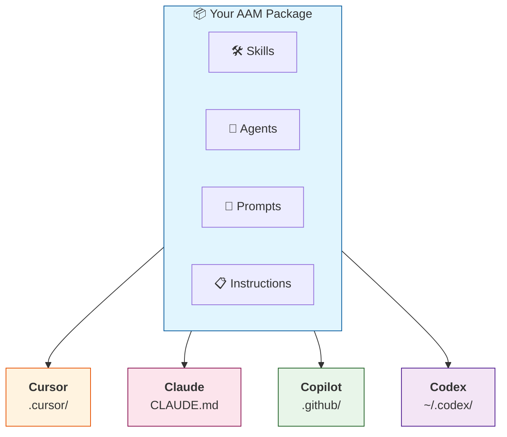
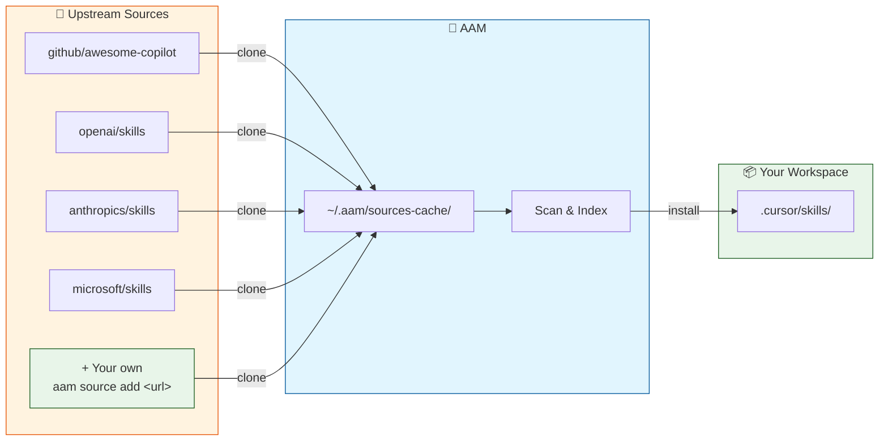
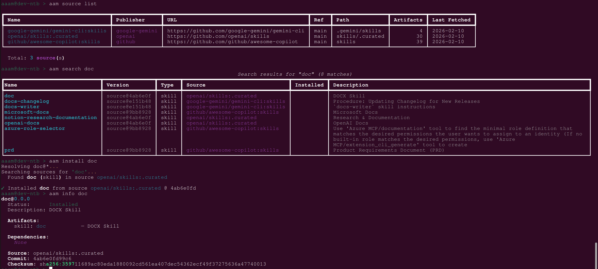

# AAM — Agent Artifact Manager

**The package manager for AI agent artifacts.**

Package, share, and deploy skills, agents, prompts, and instructions across Cursor, Claude, GitHub Copilot, and more.

```bash
pip install "git+https://github.com/spazyCZ/agent-package-manager.git#subdirectory=apps/aam-cli"
```

---

## Why AAM?

We know how to manage software dependencies with `npm` and `pip`. But when it comes to agentic development — prompts, skills, agent configurations, and instruction sets — the ecosystem is still fragmented.

AAM makes agent artifacts **versionable, packageable, and shareable** — just like software dependencies.

| Status | Problem | Description |
|--------|---------|-------------|
| ✅ **Solved** | **Tracking distributed skills** | Skills live across multiple repositories and providers. AAM's git sources workflow unifies discovery, versioning, and synchronization. |
| 🔄 **In progress** | **Packaging artifacts** | Real use-cases combine skills, agent configs, and prompts. AAM packages them into reusable, shareable units. |
| 🔄 **In progress** | **Registry for agent artifacts** | There's no `npm` for agent artifacts. AAM provides a registry to publish, discover, and install them. |



---

## Quick Start

### 1. Use remote skills

Set up default sources and fetch community skills:

```bash
aam init                    # First time: configure platform + default sources
aam source update --all     # Clone and scan upstream repositories
aam search python           # Search for skills
aam install code-reviewer   # Install a skill to your workspace
```

### 2. Create your own package

**From an existing project** (autodetect skills and agents):

```bash
cd my-project/
aam pkg create

# Scanning for artifacts not managed by AAM...
# Found 3 artifacts:
#   [x] 1. code-reviewer     .cursor/skills/code-reviewer/SKILL.md
#   [x] 2. security-auditor  .cursor/rules/agent-security-auditor.mdc
#   [x] 3. python-rules      .cursor/rules/python-rules.mdc
#
# ✓ Package created: my-project@1.0.0
```

**From scratch:**

```bash
mkdir my-awesome-skill && cd my-awesome-skill
aam pkg init

# ✓ Created my-awesome-skill/
#     ├── package.agent.json
#     ├── skills/
#     ├── prompts/
#     └── commands/
```

**Validate, pack, and publish:**

```bash
aam pkg validate    # Check package is valid
aam pkg pack        # Build the archive
aam pkg publish     # Upload to registry
```

---

## Default Skill Sources

On first run or when you run `aam source enable-defaults`, AAM registers 4 curated community repositories:

| Source | Repository | Path |
|--------|------------|------|
| `github/awesome-copilot` | [github/awesome-copilot](https://github.com/github/awesome-copilot) | `skills` |
| `openai/skills:.curated` | [openai/skills](https://github.com/openai/skills) | `skills/.curated` |
| `anthropics/skills` | [anthropics/skills](https://github.com/anthropics/skills) | `skills` |
| `microsoft/skills` | [microsoft/skills](https://github.com/microsoft/skills) | `.github/skills` |

After enabling defaults, run `aam source update --all` to clone and scan. Remove sources with `aam source remove`, re-enable with `aam source enable-defaults`.

AAM tracks and unifies skills from multiple community repositories:





---

## MCP Server

AAM includes a built-in [Model Context Protocol](https://modelcontextprotocol.io) server, allowing IDE agents to interact with AAM directly — search packages, manage sources, install skills, and get recommendations without leaving the editor.

```bash
# Start read-only server (default, safe for any IDE)
aam mcp serve

# Enable write operations (install, publish, source management)
aam mcp serve --allow-write
```

**IDE configuration (Cursor, Claude Desktop, Windsurf, VS Code):**

```json
{
  "mcpServers": {
    "aam": {
      "command": "aam",
      "args": ["mcp", "serve"]
    }
  }
}
```

The server exposes **35 tools** and **9 resources**:

| Category | Read-only tools | Write tools (opt-in) |
|----------|----------------|---------------------|
| **Packages** | `search`, `list`, `info`, `validate` | `install`, `uninstall`, `publish`, `create_package` |
| **Sources** | `source_list`, `source_scan`, `source_candidates`, `source_diff` | `source_add`, `source_remove`, `source_update` |
| **Config** | `config_get`, `doctor`, `registry_list` | `config_set`, `registry_add`, `init` |
| **Discovery** | `recommend_skills`, `available`, `outdated` | `upgrade`, `init_package` |
| **Integrity** | `verify`, `diff` | — |
| **Dependencies** | `tree`, `why`, `check`, `audit`, `dedupe`, `prune` | — |

**Options:**

| Flag | Description |
|------|-------------|
| `--transport` | `stdio` (default) or `http` |
| `--port PORT` | HTTP port (default: `8000`, HTTP transport only) |
| `--allow-write` | Enable write tools (install, publish, source management). Without this flag, only read-only tools are available. |
| `--log-file PATH` | Log to file instead of stderr |
| `--log-level` | `DEBUG`, `INFO`, `WARNING`, `ERROR` |

---

## Features

- **One package, all platforms** — Write once, deploy to Cursor, Claude, GitHub Copilot, and Codex
- **Dependency management** — Declare dependencies, AAM resolves them automatically
- **Local & centralized registries** — Work offline or share with the community
- **Package signing** — Sigstore (keyless) and GPG signature support
- **MCP server** — IDE agents can use AAM tools directly via Model Context Protocol
- **Simple CLI** — Intuitive commands: `init`, `install`, `pkg publish`, `source`

---

## CLI Commands

### Using skills from source

| Command | Description |
|---------|-------------|
| `aam init` | Set up AAM (platform, default sources) |
| `aam install <pkg>` | Install a package and dependencies |
| `aam uninstall <pkg>` | Remove an installed package |
| `aam upgrade` | Update packages to latest compatible versions |
| `aam list` | List installed packages |
| `aam search <query>` | Search registry and sources for packages |
| `aam info <pkg>` | Show package details |
| `aam source` | Manage git artifact sources (add, list, update, remove) |
| `aam registry` | Manage registries (init, add, list) |
| `aam config` | Manage configuration |
| `aam tree` | Display the resolved dependency tree |
| `aam why <pkg>` | Show why a package is installed |
| `aam check` | Check installation health and system dependencies |
| `aam audit` | Audit installed packages for integrity issues |
| `aam dedupe` | Detect and remove duplicate installations |
| `aam prune` | Remove unlocked package directories |

### Package authoring (pkg)

| Command | Description |
|---------|-------------|
| `aam pkg create` | Create package from existing project (autodetect + interactive) |
| `aam pkg init` | Create a new package from scratch (interactive) |
| `aam pkg validate` | Validate package manifest and artifacts |
| `aam pkg pack` | Build distributable `.aam` archive |
| `aam pkg publish` | Publish package to registry |

---

## Package Structure

```
my-package/
├── package.agent.json          # Package manifest (required)
├── agents/                     # Agent definitions
│   └── my-agent/
│       ├── agent.yaml
│       └── system-prompt.md
├── skills/                     # Skills
│   └── my-skill/
│       └── SKILL.md
├── prompts/                    # Prompt templates
│   └── my-prompt.md
├── commands/                   # Slash commands
│   └── review.md
├── rules/                      # Platform rules
│   └── coding-standards/
│       └── RULE.md
├── hooks/                      # Lifecycle hooks
│   └── hooks.json
└── mcp/                        # MCP server configs
    └── servers.json
```

### Package Manifest (`package.agent.json`)

> `aam.yaml` is still supported for backward compatibility. New packages
> use `package.agent.json` by default.

```json
{
  "name": "my-package",
  "version": "1.0.0",
  "description": "My awesome AI agent package",
  "author": "your-username",
  "license": "Apache-2.0",
  "artifacts": {
    "skills": [
      { "name": "my-skill", "path": "skills/my-skill/",
        "description": "Does something useful" }
    ],
    "prompts": [
      { "name": "my-prompt", "path": "prompts/my-prompt.md" }
    ]
  },
  "dependencies": {
    "common-utils": "^1.0.0"
  }
}
```

---

## Platform Support

AAM automatically deploys artifacts to the correct locations for each platform:

| Platform | Skills | Agents | Prompts | Instructions | Commands | Rules | Hooks | MCP |
|----------|--------|--------|---------|--------------|----------|-------|-------|-----|
| **Cursor** | `.cursor/skills/` | `.cursor/rules/` | `.cursor/prompts/` | `.cursor/rules/` | `.cursor/skills/` | `.cursor/rules/` | `.cursor/hooks.json` | `.cursor/mcp.json` |
| **Claude** | `.claude/skills/` | `.claude/agents/` | `.claude/prompts/` | `CLAUDE.md` | `.claude/commands/` | `CLAUDE.md` | `.claude/hooks.json` | `.mcp.json` |
| **Copilot** | `.github/skills/` | `.github/agents/` | `.github/prompts/` | `.github/instructions/` | `.github/prompts/` | `.github/instructions/` | `.github/copilot-hooks.json` | `.vscode/mcp.json` |
| **Codex** | `~/.codex/skills/` | `AGENTS.md` | `~/.codex/prompts/` | `AGENTS.md` | `~/.codex/skills/` | `AGENTS.md` | *(not supported)* | *(limited)* |

---

## Configuration

### Global Configuration (`~/.aam/config.yaml`)

```yaml
default_platform: cursor

active_platforms:
  - cursor
  - claude

registries:
  - name: aam-central
    url: https://registry.aam.dev
    type: http

security:
  require_signature: false
  on_unsigned: warn
```

### Project Configuration (`.aam/config.yaml`)

```yaml
default_platform: cursor

platforms:
  cursor:
    skill_scope: project
```

---

## Documentation

- **[User Guide](docs/USER_GUIDE.md)** — Complete walkthrough with examples
- **[Design Document](docs/DESIGN.md)** — Architecture and technical details
- **[HTTP Registry Spec](docs/HTTP_REGISTRY_SPEC.md)** — API specification for registry service

## Contributing

Contributions welcome! See [CONTRIBUTING.md](CONTRIBUTING.md) for development setup and guidelines.

## License

Apache License 2.0 — see [LICENSE](LICENSE) for details.

<p align="center">
  <strong>Built for the AI agent ecosystem.</strong><br>
  Package once. Deploy everywhere.
</p>
