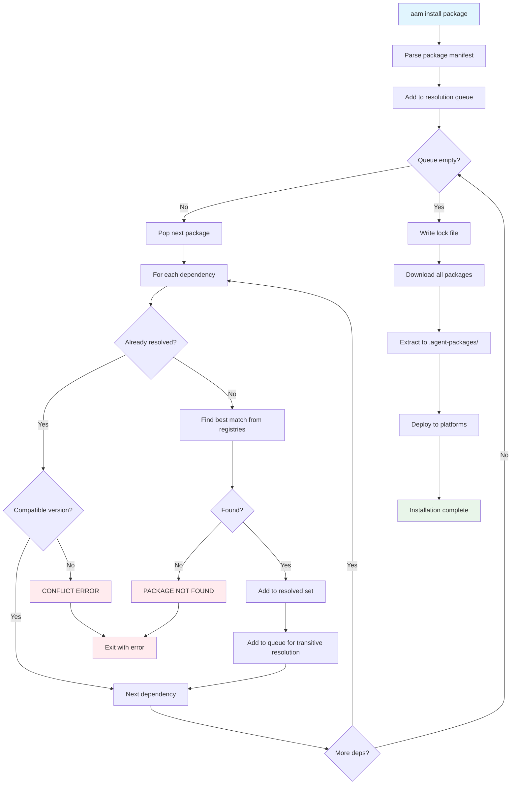

# Dependencies

**Dependencies** enable artifact reuse and composition in AAM. A package can depend on other packages, and AAM automatically resolves, downloads, and deploys all required dependencies.

## Why Dependencies?

Dependencies solve several problems:

1. **Reuse** — Build on existing skills and agents without copying code
2. **Composition** — Combine multiple packages into complex workflows
3. **Consistency** — Everyone uses the same version of shared artifacts
4. **Updates** — Update a dependency once, all dependents benefit

### Example: Agent with Dependencies

```yaml
# @author/asvc-auditor/aam.yaml
name: "@author/asvc-auditor"
version: 1.0.0

artifacts:
  agents:
    - name: asvc-audit
      path: agents/asvc-audit/
      description: "ASVC compliance auditor"
  skills:
    - name: asvc-report
      path: skills/asvc-report/
      description: "Generate ASVC audit reports"

dependencies:
  "@author/generic-auditor": ">=1.0.0"  # Reuse generic auditing skill
  report-templates: "^2.0.0"            # Reuse report templates
```

When you install `@author/asvc-auditor`, AAM automatically:

1. Resolves dependencies (`@author/generic-auditor` and `report-templates`)
2. Downloads all packages
3. Deploys all artifacts (agent + skills from all 3 packages)

---

## Dependency types

AAM supports four dependency types, each with different install
behavior:

| Type | Manifest key | Behavior |
|------|-------------|----------|
| **Required** | `dependencies` | Must resolve and install; install fails if missing |
| **Optional** | `optionalDependencies` | Install continues gracefully if the package is unavailable |
| **Peer** | `peerDependencies` | Must be satisfied by the host project; not auto-installed |
| **System** | `systemDependencies` | OS-level pre-flight checks (runtimes, binaries, packages) |

### Required dependencies

Standard dependencies that must be present for the package to work:

```json
{
  "dependencies": {
    "@author/generic-auditor": ">=1.0.0",
    "report-templates": "^2.0.0"
  }
}
```

### Optional dependencies

Enhance the package but are not required. Install continues if they
cannot be resolved:

```json
{
  "optionalDependencies": {
    "advanced-reporter": "^1.0.0"
  }
}
```

### Peer dependencies

Must be present in the consuming project. AAM warns if they are
missing but does not auto-install them:

```json
{
  "peerDependencies": {
    "base-framework": "^2.0.0"
  }
}
```

### System dependencies

OS-level requirements verified by pre-flight checks before any
package files are placed. See
[System dependency pre-flight checks](#system-dependency-pre-flight-checks)
below.

```json
{
  "systemDependencies": {
    "python": ">=3.11",
    "node": ">=20",
    "packages": {
      "pip": ["jinja2>=3.0"],
      "npm": ["prettier"],
      "brew": ["jq"],
      "apt": ["jq"]
    },
    "binaries": ["ruff", "git"],
    "mcp_servers": ["filesystem"]
  }
}
```

## Declaring dependencies

Dependencies are declared in `package.agent.json` (or `aam.yaml`):

```json
{
  "dependencies": {
    "@author/generic-auditor": ">=1.0.0",
    "report-templates": "^2.0.0"
  },
  "optionalDependencies": {
    "advanced-reporter": "^1.0.0"
  },
  "peerDependencies": {
    "base-framework": "^2.0.0"
  }
}
```

Both scoped (`@scope/name`) and unscoped (`name`) package names are
supported across all dependency types.

---

## Version Constraint Syntax

AAM uses semantic versioning (semver) with flexible constraint syntax:

| Syntax | Meaning | Matches | Use Case |
|--------|---------|---------|----------|
| `1.0.0` | Exact version | Only `1.0.0` | Pin to specific version |
| `>=1.0.0` | Minimum version | `1.0.0`, `1.5.0`, `2.0.0`, etc. | Accept any newer version |
| `^1.0.0` | Compatible release | `>=1.0.0`, `<2.0.0` | Accept compatible updates |
| `~1.0.0` | Approximate | `>=1.0.0`, `<1.1.0` | Accept patch updates only |
| `*` | Any version | Latest available | Always use latest |
| `>=1.0.0,<2.0.0` | Range constraint | Explicit range | Complex requirements |

### Caret (`^`) — Compatible Release

The caret (`^`) allows changes that do not modify the left-most non-zero digit:

| Constraint | Matches | Does NOT Match |
|------------|---------|----------------|
| `^1.0.0` | `1.0.0`, `1.0.1`, `1.1.0`, `1.9.9` | `2.0.0`, `0.9.0` |
| `^0.2.0` | `0.2.0`, `0.2.1`, `0.2.9` | `0.3.0`, `1.0.0` |
| `^0.0.3` | `0.0.3` | `0.0.4`, `0.1.0` |

**Rationale:** Semver convention says breaking changes increment the major version (for `>=1.0.0`) or minor version (for `0.x.y`).

### Tilde (`~`) — Approximate

The tilde (`~`) allows patch-level changes only:

| Constraint | Matches | Does NOT Match |
|------------|---------|----------------|
| `~1.0.0` | `1.0.0`, `1.0.1`, `1.0.9` | `1.1.0`, `2.0.0` |
| `~2.3.0` | `2.3.0`, `2.3.1`, `2.3.99` | `2.4.0`, `3.0.0` |

**Rationale:** Patch versions should be backwards-compatible bug fixes.

### Range Constraints

Multiple conditions can be combined with commas:

```yaml
dependencies:
  my-package: ">=1.0.0,<2.0.0"    # 1.x only
  other-package: ">=1.5.0,<1.8.0" # Specific range
```

### Choosing the Right Constraint

| Scenario | Constraint | Example |
|----------|-----------|---------|
| Tested with specific version | Exact | `1.0.0` |
| Need specific feature | Minimum | `>=1.5.0` |
| Trust semver compatibility | Caret | `^1.0.0` |
| Only want bug fixes | Tilde | `~1.0.0` |
| Always use latest | Wildcard | `*` |
| Complex requirements | Range | `>=1.0.0,<2.0.0` |

**Recommendation:** Use `^` (caret) for most dependencies. It balances flexibility and safety.

---

## Resolution algorithm

AAM uses a **greedy breadth-first search (BFS)** algorithm with
**dependency hoisting**, **circular dependency detection**, and
conflict reporting. This is simpler than npm's nested dependencies
but more flexible than pip's strict single-version resolution.

### Key principles

1. **Single version per dependency** — No nested dependencies like npm
2. **Dependency hoisting** — Compatible shared transitive dependencies
   are flattened to the install root to minimize duplication
3. **Circular dependency detection** — Cycles in the dependency graph
   are detected and reported as errors before installation
4. **Fail on conflict** — Report conflicts clearly, don't try to
   resolve automatically
5. **Breadth-first** — Process dependencies level-by-level

### Resolution strategies

You can control how the resolver selects versions using flags on
`aam install`:

| Flag | Behavior |
|------|----------|
| *(default)* | Select the highest compatible version |
| `--frozen` | Use exact versions from `package.agent.lock`; fail if the lock file is missing or stale |
| `--minimal` | Select the lowest version satisfying each constraint (most conservative) |
| `--latest` | Select the highest available version for each package, ignoring lock file |
| `--dry-run` | Resolve and display the dependency tree without installing |

These flags are mutually exclusive (except `--dry-run`, which
combines with any strategy).

### Version overrides (`resolutions`)

You can force a specific version for any transitive dependency using
the `resolutions` field in `package.agent.json`:

```json
{
  "resolutions": {
    "problematic-package": "1.2.3"
  }
}
```

This bypasses normal constraint resolution for the specified package.

### `find_best_match` Logic

When resolving a constraint like `^1.0.0`:

1. **Query all registries** — Get all available versions of the package
2. **Filter by constraint** — Keep only versions matching `^1.0.0`
3. **Pick highest** — Select the highest version from filtered list
4. **Return** — Download and parse manifest

```python
def find_best_match(package_name, constraint):
    # Get all versions from registries
    all_versions = registry.get_versions(package_name)

    # Filter by constraint
    matching = [v for v in all_versions if constraint.satisfies(v)]

    if not matching:
        raise PackageNotFoundError(f"No version of {package_name} matches {constraint}")

    # Return highest matching version
    return max(matching, key=parse_semver)
```

### Resolution Order

Dependencies are resolved in **breadth-first order**:

```
Package A
├── Dependency B (^1.0.0)
│   ├── Dependency D (>=2.0.0)
│   └── Dependency E (~3.0.0)
└── Dependency C (^2.0.0)
    └── Dependency D (>=2.1.0)
```

**Resolution order:**

1. Resolve `A` (root)
2. Resolve `B` and `C` (level 1)
3. Resolve `D` and `E` (level 2)
4. Check that `D`'s version satisfies both `B`'s and `C`'s constraints

### Example: Successful Resolution

```yaml
# Package A
dependencies:
  B: "^1.0.0"
  C: "^2.0.0"

# Package B
dependencies:
  D: ">=2.0.0"

# Package C
dependencies:
  D: ">=2.1.0"
```

**Available versions:**
- `B`: `1.0.0`, `1.5.0`, `1.9.0`
- `C`: `2.0.0`, `2.3.0`
- `D`: `2.0.0`, `2.1.0`, `2.5.0`

**Resolution:**

1. Install `A` (root)
2. Resolve `B: ^1.0.0` → Pick `1.9.0` (highest matching)
3. Resolve `C: ^2.0.0` → Pick `2.3.0` (highest matching)
4. Resolve `D` from `B: >=2.0.0` → Pick `2.5.0` (highest matching)
5. Check `D` from `C: >=2.1.0` → `2.5.0` satisfies, continue
6. Success

**Final resolved versions:**
- `A: 1.0.0`
- `B: 1.9.0`
- `C: 2.3.0`
- `D: 2.5.0`

---

## Conflict Handling

A **conflict** occurs when two packages require incompatible versions of the same dependency.

### Example: Conflicting Constraints

```yaml
# Package A
dependencies:
  B: "^1.0.0"
  C: "^2.0.0"

# Package B
dependencies:
  D: ">=3.0.0"  # Requires D >= 3.0.0

# Package C
dependencies:
  D: "<3.0.0"   # Requires D < 3.0.0
```

**No version of D satisfies both constraints.**

### Conflict Error Message

When AAM detects a conflict, it reports it clearly:

```
ERROR: Dependency conflict

  Package B@1.5.0 requires D >=3.0.0
  Package C@2.1.0 requires D <3.0.0

No version of D satisfies both constraints.

Suggestions:
  1. Check if newer versions of B or C relax the constraint
  2. Use `aam info B` and `aam info C` to see latest versions
  3. Install packages in separate projects if truly incompatible
```

### Resolving Conflicts

When you encounter a conflict:

1. **Check for updates** — Newer versions may have relaxed constraints

    ```bash
    aam search B
    aam search C
    ```

2. **Review dependency chains** — Understand why the conflict exists

    ```bash
    aam list --tree
    ```

3. **Contact package authors** — Ask them to relax overly strict constraints

4. **Use separate projects** — If packages are truly incompatible, install in different workspaces

5. **Fork and modify** — As a last resort, fork a package and adjust its constraints

### Why No Multiple Versions?

Unlike npm (which allows multiple versions of the same package via nested `node_modules`), AAM enforces **single-version resolution**.

**Rationale:**

- **Agent artifacts must converge** — Skills and instructions can't have conflicting behaviors
- **Simpler mental model** — Easier to reason about what's installed
- **Smaller deployments** — No duplication of artifacts
- **Platform limitations** — Most platforms don't support multiple versions of the same artifact

---

## Lock file: `package.agent.lock`

The lock file records the **exact versions** resolved during
installation. This ensures reproducible installs across machines and
time. The lock file uses JSON format and is located at the project
root as `package.agent.lock`.

!!! note "Migration from `aam-lock.yaml`"
    The old `aam-lock.yaml` format is superseded by
    `package.agent.lock` (JSON). AAM detects the old format and
    offers to convert it automatically.

### Lock file schema

```json
{
  "lockfile_version": 2,
  "resolved_at": "2026-02-20T14:30:00Z",
  "packages": {
    "@author/asvc-auditor": {
      "version": "1.0.0",
      "source": "aam-central",
      "checksum": "sha256:abc123...",
      "dependencies": {
        "@author/generic-auditor": "1.2.3",
        "report-templates": "2.1.0"
      }
    }
  },
  "systemChecks": {
    "python": { "required": ">=3.11", "found": "3.12.1" },
    "node": { "required": ">=20", "found": "20.11.0" }
  }
}
```

The `systemChecks` section records the results of system dependency
verification, providing an audit trail of what was available at
install time.

### Lock file workflow

```bash
# Developer A: Install and commit lock file
aam install @author/asvc-auditor
git add package.agent.lock
git commit -m "Add ASVC auditor and dependencies"

# Developer B: Clone and install exact versions
git clone https://github.com/myorg/my-project.git
cd my-project
aam install --frozen  # Use exact locked versions
```

### Lock file best practices

1. **Always commit lock files** — Ensures reproducible builds
2. **Use `--frozen` in CI** — Fail fast if lock file is stale
3. **Don't edit manually** — Let AAM manage it
4. **Update regularly** — Keep dependencies current with `aam update`

---

## Transitive Dependencies

**Transitive dependencies** are dependencies of your dependencies:

```
Your Package (A)
└── Dependency B
    └── Dependency C (transitive)
        └── Dependency D (transitive)
```

AAM automatically resolves and installs all transitive dependencies.

### Example

```yaml
# Your package
name: my-agent
dependencies:
  code-reviewer: "^1.0.0"

# code-reviewer package
name: code-reviewer
dependencies:
  python-linter: "^2.0.0"
  js-linter: "^3.0.0"

# python-linter package
name: python-linter
dependencies:
  ast-parser: "^1.0.0"
```

When you run `aam install`, AAM installs:
- `my-agent` (root)
- `code-reviewer` (direct dependency)
- `python-linter` (transitive)
- `js-linter` (transitive)
- `ast-parser` (transitive)

### Viewing dependency trees

```bash
aam tree
```

**Output:**

```
project (5 packages)
├── my-agent@1.0.0
│   └── code-reviewer@1.5.0
│       ├── python-linter@2.3.0
│       │   └── ast-parser@1.2.0
│       └── js-linter@3.1.0
```

Use `aam why <package>` to understand why a specific transitive
dependency is installed:

```bash
aam why ast-parser
```

---

## Resolution Process Diagram



---

## System dependency pre-flight checks

When a package declares `systemDependencies`, AAM runs pre-flight
checks before installing any package files. This catches missing
runtimes, binaries, and package manager packages early.

### What is checked

| Category | Example | Check method |
|----------|---------|-------------|
| Runtime versions | `python >= 3.11` | Version command output |
| OS binaries | `ruff`, `git`, `jq` | `$PATH` lookup |
| pip packages | `jinja2>=3.0` | `pip show` |
| npm packages | `prettier` | `npm list -g` |
| brew packages | `jq` | `brew list` |
| apt packages | `jq` | `dpkg -s` |
| MCP servers | `filesystem` | MCP registry lookup |

### Auto-install behavior

| Flag | pip/npm | brew/apt |
|------|---------|----------|
| *(none)* | Prompt user | Prompt user |
| `--install-system-deps` | Auto-install | Prompt user |
| `--install-system-deps --allow-sudo` | Auto-install | Auto-install |
| `--skip-checks` | Skip all checks | Skip all checks |

### Standalone check

You can verify system dependencies at any time without installing:

```bash
aam check --system
```

---

## Dependency hoisting and deduplication

AAM hoists compatible shared transitive dependencies to the install
root (`.agent-packages/`) to minimize duplication. When two packages
require compatible versions of the same dependency, only one copy is
installed.

If duplication occurs (for example, after a migration), use
`aam dedupe` to flatten the tree:

```bash
aam dedupe --dry-run   # Preview
aam dedupe             # Apply
```

Use `aam prune` to remove directories not tracked in the lock file:

```bash
aam prune --dry-run    # Preview
aam prune              # Apply
```

---

## Circular dependency detection

AAM treats circular dependency graphs as hard errors. If package A
depends on B and B depends on A, the resolver reports the cycle path
and refuses to install:

```
ERROR: Circular dependency detected

  A@1.0.0 → B@2.0.0 → A@1.0.0

Remove the cycle before installing.
```

---

## Best Practices

### For Package Authors

1. **Use caret constraints** — `^1.0.0` allows compatible updates
2. **Avoid overly strict constraints** — Don't pin unnecessarily
3. **Test with latest** — Ensure your package works with newer dependencies
4. **Document breaking changes** — Increment major version for breaking changes
5. **Minimize dependencies** — Only depend on what you actually need

### For Package Consumers

1. **Commit lock files** — Ensure reproducible installs
2. **Review dependency trees** — Understand what you're installing
3. **Update regularly** — Keep dependencies current
4. **Check for conflicts** — Run `aam install` to detect issues early
5. **Pin in production** — Use exact versions for production deployments

### For Teams

1. **Shared registries** — Use private registries for internal packages
2. **Dependency policies** — Set rules for approved dependencies
3. **Regular audits** — Review dependencies periodically
4. **Update cadence** — Establish a regular update schedule
5. **CI/CD validation** — Test with lock file in CI

---

## Comparison with Other Package Managers

| Feature | AAM | npm | pip | Go modules |
|---------|-----|-----|-----|------------|
| **Multiple versions** | No | Yes (nested) | No | Yes (MVS) |
| **Conflict resolution** | Fail fast | Nested dependencies | Fail fast | Minimal version |
| **Lock file** | Yes | Yes (package-lock.json) | Yes (requirements.txt) | Yes (go.sum) |
| **Transitive deps** | Yes | Yes | Yes | Yes |
| **Constraint syntax** | Semver + operators | Semver + operators | Various | Semver + operators |

**AAM's approach:**

- **Simpler than npm** — No nested dependencies
- **Stricter than pip** — Always enforces lock files
- **Faster resolution** — Greedy BFS, no complex backtracking
- **Clear errors** — Explicit conflict messages

---

## Next Steps

- **Learn about lock files:** See [Lock Files](../configuration/lock-files.md) for lock file management
- **Understand security:** See [Security](security.md) for dependency verification
- **Manage your tree:** See [`aam tree`](../cli/tree.md), [`aam why`](../cli/why.md), [`aam check`](../cli/check.md)
- **Create packages:** See [Tutorial: Create a Package](../tutorials/package-existing-skills.md)
- **Deploy artifacts:** See [Platform Adapters](platform-adapters.md)
